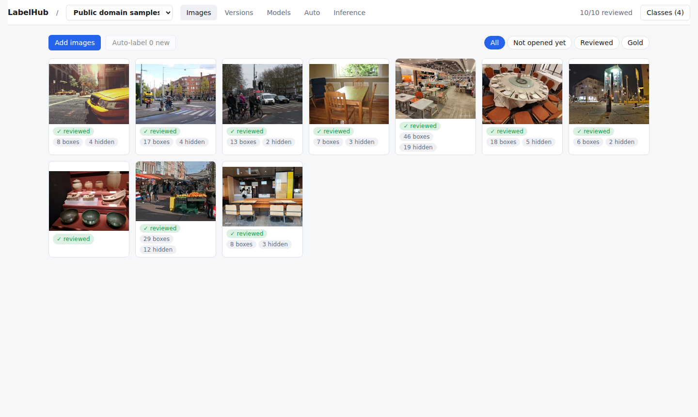
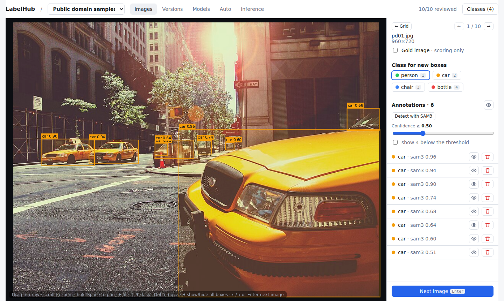
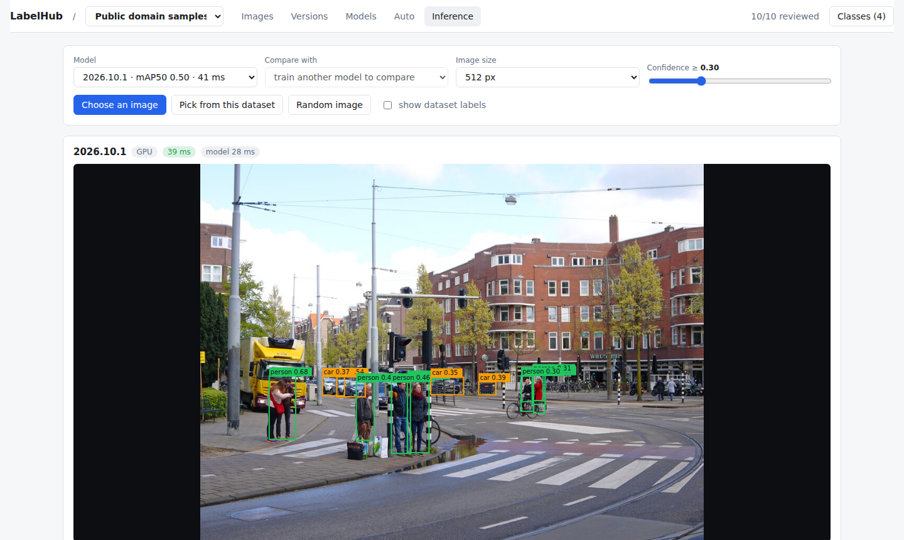
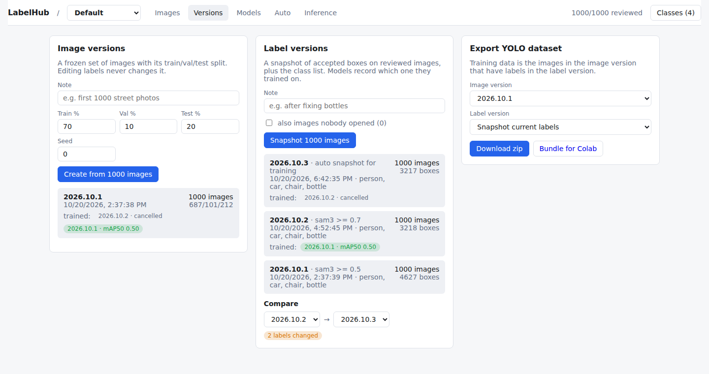
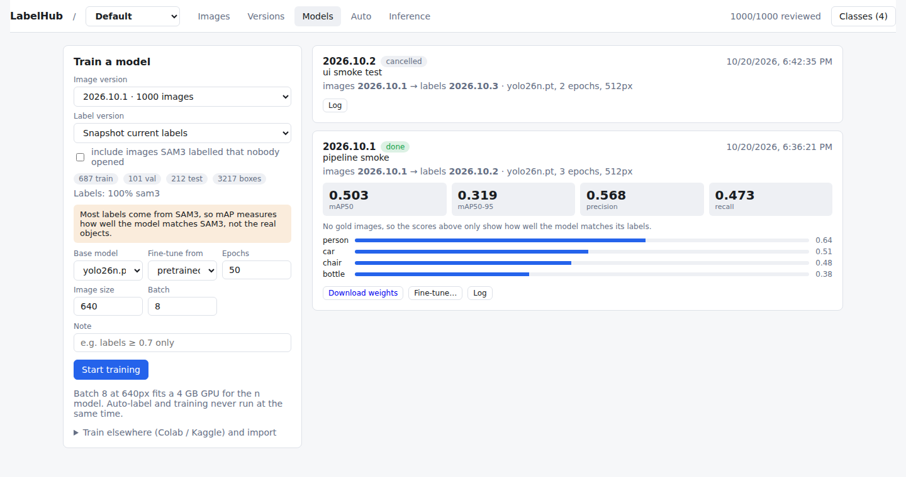
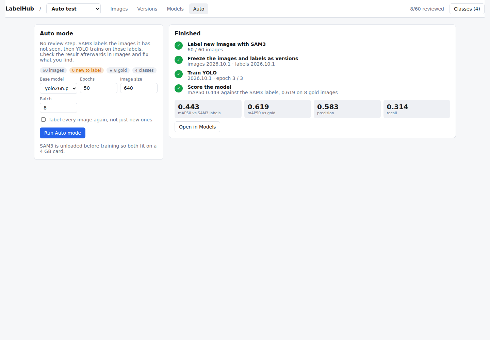

# LabelHub

A small, self-hosted platform that takes you from raw images to a deployed object detector: label boxes (by hand or with SAM3), freeze versions of your images, labels and models, train YOLO, and try the result, all on a single 4 GB GPU.

The idea: SAM3 draws the first boxes, you only fix what is wrong (or skip the review entirely in Auto mode), and every model remembers exactly which images and which labels it was trained on.

| Images | Editor |
|---|---|
|  |  |
| **Inference** | **Versions** |
|  |  |
| **Models** | **Auto mode** |
|  |  |

The photos in the screenshots are public domain or CC0, from Wikimedia Commons ([credits](docs/screenshots/CREDITS.md)). The repository itself contains no dataset images.

## What it does

- **Datasets.** Each dataset has its own images, classes, versions and models, stored in its own folder.
- **Labelling.** Draw, move and resize boxes on a zoomable canvas. SAM3 proposes boxes for your class names; opening an image counts as reviewing it, a confidence slider (0.3 to 1.0) decides which SAM3 boxes are kept, and an eye button hides any box (or all of them) to see the raw image.
- **Three kinds of version, git-style.** An *image version* freezes the set of images and their train/val/test split, a *label version* freezes the boxes and class list, and a *model version* records the pair it was trained on. Names are `YYYY.MM.x`. Editing labels never changes an image version, and every model can be traced back to the exact data it saw.
- **Two modes.** *Manual*: SAM3 labels, you review, you train. *Auto*: one button runs SAM3 labelling, versioning, YOLO training and scoring with no human in the loop.
- **Gold images.** Images you have checked by hand can be marked gold. They are never trained on, and each model gets a second score against them, because a model trained on SAM3's labels scored against SAM3's labels only measures how well it copies SAM3.
- **Training.** YOLO26 n or s, fine-tuned from pretrained weights or from one of your own models, run as a background process with live progress and a cancel button. You can also export a bundle (with a training script) for Colab or Kaggle and import the weights back.
- **Inference.** Try any model on a dropped file or a dataset image, compare two models side by side, overlay the dataset's labels, and call the same endpoint from your own code. Every run is logged, and latency percentiles show up on the model card.

## How it fits on 4 GB

Only one GPU job runs at a time. SAM3 (fp16, about 2.1 GB) is unloaded before training starts, training runs in its own process, and inference falls back to the CPU while a model is training. SAM3 encodes each image once and reuses the result for every class prompt.

Measured on an RTX 3050 Ti Laptop (4 GB) with an 800x534 image: SAM3 peak VRAM 2.1 GB, 0.58 s to encode an image plus about 0.13 s per extra class. A YOLO26n model answers in about 22 ms (median, including decoding) on the same GPU.

## Results so far

A distillation experiment on 1,000 random COCO val2017 photos with four classes (person, car, chair, bottle), run end to end through the app:

- SAM3 labelled the images in about 19 minutes. Fine-tuning pretrained YOLO26n for 50 epochs took 748 s and reached **mAP50 0.50** on 212 held-out images, measured against SAM3's own labels.
- Keeping only SAM3 boxes of 0.7 and above and re-scoring both models on the same test split gave the same mAP50 (0.598 against 0.597): the stricter labels traded recall for precision.
- Auto mode on 60 photos with 8 gold images and 3 epochs finished in about 7 minutes: mAP50 0.44 against SAM3's labels and 0.62 against the gold images.

Read these as a check that the pipeline works, not as a benchmark. The pretrained YOLO weights have already seen COCO, the gold images in that run were opened but not corrected, and a score against SAM3's labels is an agreement score, not accuracy.

## Run it

You need Linux or WSL, Python 3.12 or newer, a recent Node, and an NVIDIA GPU (4 GB or more) for SAM3 and training. It has been run on WSL2 with Python 3.14 and Node 24, and nothing else has been tried. SAM3 is a gated model: request access to [facebook/sam3](https://huggingface.co/facebook/sam3) on Hugging Face and put a token in `.env`.

```bash
python -m venv .venv && source .venv/bin/activate
pip install torch torchvision   # pick the build for your CUDA version
pip install -r requirements.txt
echo "HF_TOKEN=hf_..." > .env

(cd frontend && npm install && npm run build)
LABELHUB_DATA=./data uvicorn labelhub.projects:create_server --factory --port 8000
```

Open http://localhost:8000, create a dataset, add images and classes, then use Auto-label on the Images tab, or the Auto tab for the whole pipeline. The routes live in `labelhub/api.py`.

Call a model from code:

```bash
curl -X POST -F file=@photo.jpg -F conf=0.25 \
  http://localhost:8000/api/p/<dataset>/models/<model>/predict
```

Tests: `python -m pytest -q`. The inference tests need a local `yolo26n.pt` and skip themselves without one.

## Layout

```
labelhub/    FastAPI backend: datasets, versions, SAM3 auto-label, training worker, auto pipeline, inference
frontend/    React + Vite + TypeScript UI, plus a static demo build with a mock API
tests/       pytest suite (versioning, API, training lifecycle, auto pipeline, inference)
experiments/ COCO distillation, SAM3 probes, comparison plots
SPEC.md      design notes: what was built, why, and what was rejected
```

`npm run build:demo` produces a single-file demo that runs without a server, using SAM3 boxes and model predictions recorded from a local run. Training, export and SAM3 itself are disabled there. The recorded data (`frontend/src/demo/data.json`, which embeds sample photos) is not in the repository; generate it from your own dataset and trained model with `frontend/scripts/make_demo_data.py` and `add_demo_predictions.py`, then run `python frontend/scripts/make_artifact.py` if you want a Claude artifact page.

## Limits and what is next

- One user, no login. Each dataset is an SQLite database plus folders on disk.
- Boxes only; segmentation masks and video are not supported yet.
- The state of an Auto run lives in server memory. If the server restarts mid-run, the training process finishes but the Auto page forgets the steps.
- Not done: a TensorRT backend for faster SAM3 labelling, and a self-training loop where a trained YOLO proposes labels for new images.

## Credits and licences

LabelHub is released under the [Apache License 2.0](LICENSE).

It builds on other projects, each under its own licence and none of them bundled here: [SAM 3](https://github.com/facebookresearch/sam3) (gated model with its own licence, downloaded from Hugging Face), [Ultralytics YOLO](https://github.com/ultralytics/ultralytics) (AGPL-3.0, installed from PyPI), Hugging Face Transformers (Apache-2.0), FastAPI, SQLModel, React, Konva and Vite. If you run or redistribute LabelHub together with Ultralytics, the AGPL-3.0 terms of that package apply to the combination. The TensorRT export work this project draws on is in [SAM3-DeepStream](https://github.com/tuan2k33/SAM3-DeepStream).

The experiments above used photos from COCO val2017, downloaded locally and not included here; they keep their original Flickr licences (see the [COCO terms of use](https://cocodataset.org/#termsofuse)).
